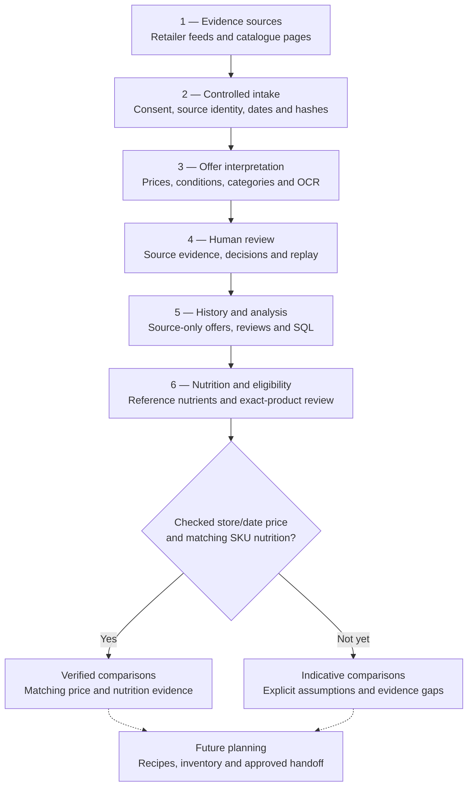

# NutriValue


[](LICENSE)


[](https://github.com/wintersyntax/nutrivalue-portfolio/actions/workflows/portfolio-ci.yml)

**From Norwegian grocery advertisements and nutrition evidence to explainable price comparisons and human-reviewed shopping decisions.**

NutriValue is a personal data-engineering and applied-AI project. It explores how to gather and track Norwegian grocery offers, interpret catalogue pages, extract prices and promotion terms, classify products, check identity and nutritional evidence, and ultimately work out what food is worth buying and cooking.

**One product, one name:** NutriValue is the complete project, from observed offers and source-only price history to its planned recipe, inventory and nutrition-aware meal-planning functionality. Earlier design labels were working names for this **same product**, not extra applications or an independently shipped suite. The starting question is simple:

> **How can grocery offers, food prices and reliable nutrition data support better shopping and meal-prep decisions?**

The engineering challenge is not just fetching prices. A catalogue may show a member discount, a multibuy offer, a previous price, a price per kilogram, an assortment badge, or incomplete OCR. Matvaretabellen may describe a generic food rather than the branded SKU being sold. NutriValue keeps these facts separate and makes uncertainty **visible** instead of silently manufacturing a convincing but unsupported result.

**This is a code portfolio, not just a concept document.** The repository publishes a curated, substantial snapshot of actual Python, SQL, reviewer, OCR-research and test code alongside a small, offline, fully synthetic demo. The review-interface screenshot below uses synthetic demonstration content to illustrate the implemented review controls; it is not a live retailer observation. Raw provider responses, full flyer archives, personal datasets, credentials and owner-specific infrastructure configuration are not published.

## What it does

| Capability | Engineering implemented in this repository | Reality check |
| --- | --- | --- |
| Grocery source intake | KIWI, REMA, Coop, MENY, Kassalapp and Tjek adapter/pilot modules | Requires separately authorized sources and captured data |
| Weekly catalogue collection | Nine-chain scoped collection, date/source identity, duplicate and hotspot handling | A captured listing is not a verified checkout price |
| Product normalization | Norwegian categories, food roles, unit prices, bundles, member and standing promotion terms | Ambiguous items remain flagged; no guessed SKU/nutrition matches |
| Flyer processing | OCR region analysis, archived W40–W43 research, page candidate extraction | Experimental price recognition is **not production-ready** |
| Model-assisted promotion extraction | Strict structured outputs, two-model comparison, source/OCR cross-checks, budgeted benchmarks | Model agreement is not a reference answer |
| Human offer review | Web/terminal review flows, evidence display, explicit decisions and replay-safe logs | Human approval of a page offer does not verify store price |
| Weekly offer history | SQL schemas and queries for imported source-only runs, coverage, promotion monitoring and history | Genuine private/provider data are **not distributed** |
| Offline product candidate matching | Adapted TASK-069/TASK-070 scoring of supplied NGData/Kassalapp-shaped data, pack and brand comparisons, and nutrition flags | Experimental review aid only: no live lookups, confirmed identities or verified prices |
| Nutrition and protein economics | Generic nutrition schemas, GTIN guardrails, SKU review, Decimal NOK per protein | No independently verified real current-store price ranking |
| Meal planning, inventory and approved handoff | Defined, reviewed-first path to versioned recipes, deterministic 3+4-day proposals, package-level shopping, stock snapshots and optional Mealie sync | GET-only Mealie reader and offline recipe estimates included; planning, Grocy, TickTick and Mealie writes remain future work |

## Private implementation versus this public release

This repository contains curated Python and SQL source and an offline synthetic demo. Personal data, provider captures, credentials and deployment settings stay private.

The published engine includes a GET-only Mealie recipe reader and offline nutrition estimates. See the [architecture guide](docs/ARCHITECTURE_AND_REVIEW.md) for PikaPods hosting and integration boundaries.

## Architecture — from observation to a defensible decision



This diagram separates **implemented source processing**, **human-review operations**, **strict eligibility rules** and the **planned grocery planner**. The complete [architecture and review walkthrough](docs/ARCHITECTURE_AND_REVIEW.md) goes deeper into both technical paths.

## Offer review: the human in the loop


*Synthetic demonstration of NutriValue's implemented promotion-review interface (October 2026). The displayed products, prices and model interpretations are illustrative; the image does not establish real retailer observations, verified checkout prices or measured extraction accuracy.*

NutriValue has a real review workflow, not a generic “AI detects everything” claim. The interface is implemented in [promotion_review_web.py](engine/src/nutrivalue/promotion_review_web.py) and its [CLI launcher](engine/scripts/review_promotions_web.py), with a hosted variant in [review_service.py](engine/src/nutrivalue/review_service.py).

A reviewer can inspect a specific **chain, week, catalogue and page**, compare the original page image and OCR evidence to both models' structured promotion answers, and see uncertainty, offer type, member scope and notes. From there:

- **Accept** a promotion candidate when the page evidence supports it.
- **Reject** an unsupported result, optionally explaining why.
- Mark a **page checked** when valid structured extraction is missing and the page is inspected manually.
- **Skip** unresolved evidence rather than force a false conclusion.

A [create-only decision log](engine/src/nutrivalue/review_log.py) validates reviewer events and can replay them idempotently into the latest review view. The hosted service does not rewrite the master SQLite file from the browser. The reviewer records the evidence decision; it **does not** magically establish a verified checkout price.


## Code walkthrough

The engine code is intentionally accessible in the repository rather than hidden behind descriptions:

| Start here | What to look for |
| --- | --- |
| [engine/src/nutrivalue/providers/tjek_weekly_collect.py](engine/src/nutrivalue/providers/tjek_weekly_collect.py) | Bounded weekly catalogue collection, identity and hotspot handling |
| [engine/src/nutrivalue/providers/tjek_offer_conditions.py](engine/src/nutrivalue/providers/tjek_offer_conditions.py) | Source-only offer conditions, membership, price and unit caveats |
| [engine/src/nutrivalue/offer_categories.py](engine/src/nutrivalue/offer_categories.py) | Conservative Norwegian category and food-tag vocabulary |
| [engine/src/nutrivalue/promotion_extraction.py](engine/src/nutrivalue/promotion_extraction.py) | Page extraction persistence, promotion records and review candidates |
| [engine/src/nutrivalue/promotion_crosscheck.py](engine/src/nutrivalue/promotion_crosscheck.py) | Agreement/disagreement accounting between structured interpretations |
| [engine/src/nutrivalue/promotion_review_web.py](engine/src/nutrivalue/promotion_review_web.py) | Local evidence-based review browser |
| [engine/src/nutrivalue/review_log.py](engine/src/nutrivalue/review_log.py) | Append-only decision schema, validation and replay |
| [engine/src/nutrivalue/offer_database.py](engine/src/nutrivalue/offer_database.py) | Weekly import and source-only persistence |
| [engine/src/nutrivalue/gtin.py](engine/src/nutrivalue/gtin.py) | Product identifier guardrails |
| [engine/src/nutrivalue/product_candidates.py](engine/src/nutrivalue/product_candidates.py) | Offline-only candidate parsing and scoring with [synthetic tests](engine/tests/test_product_candidates.py) |
| [engine/analytics](engine/analytics) | SQL schemas and analytic source files |
| [engine/research/rema_flyer_2026](engine/research/rema_flyer_2026) | 32 OCR experiments and reference test programs across W40–W43 |
| [engine/tests](engine/tests) | Selected engineering tests across parsing, promotion handling, stores, SQL and identity |

[Read the source tour and optional dependencies](engine/README.md).

## Run the offline synthetic demo

The top-level runnable demo is deliberately independent of the provider pipeline. It shows the same modelling philosophy using invented food and prices.

**Python 3.10+; no package installation, API keys or network needed.**

```bash
git clone https://github.com/wintersyntax/nutrivalue-portfolio.git
cd nutrivalue-portfolio

python3 scripts/build_demo.py
python3 scripts/run_reports.py
python3 -m unittest discover -s tests -v
```

It creates `data/demo.sqlite3` only if that file does not exist. The reports illustrate demo price value, strict verified-value gating, reference-food coverage, nutritional density and edible portions. Six deterministic root tests cover the self-contained fixture.

To inspect the larger source tree without capturing offers:

```bash
python3 -m compileall -q engine/src engine/scripts engine/tests engine/research
PYTHONPATH=engine/src python3 -m unittest discover -s engine/tests -p test_gtin.py -v
PYTHONPATH=engine/src python3 -m unittest discover -s engine/tests -p test_product_candidates.py -v
```

Run `python3 scripts/check_engine.py` for the portable engine suite. It explicitly reports four private-only archive/deployment modules excluded from public validation. [Portfolio validation](.github/workflows/portfolio-ci.yml) checks this suite and the synthetic demo.

## Data modelling and nutrition-aware value

NutriValue is **not built around a fixed protein serving**. Useful comparisons depend on the decision: price per package, per kilogram of edible food, per serving, and — when a product's nutrition is reliable — cost per gram of protein, energy density and other relevant nutrients. Future meal planning considers these measures together with the user's budget, recipes, available ingredients and nutritional targets.

```text
Total edible protein (g) = net edible mass (g) × protein per 100 g / 100
NOK per gram of protein = package price (NOK) / total edible protein (g)
```

For example, a **fictional** 500 g product with 10 g protein/100 g at 30 NOK contains 50 g protein and costs **0.60 NOK per gram of protein**. The [synthetic SQL ranking](analytics/queries/demo_protein_value.sql) compares that price efficiency across fictional products. The [strict verified report](analytics/queries/best_protein_value.sql) remains separate and currently has **zero qualifying real observations**.

Price, exact product identity, food form, nutritional basis, store and date all have to describe the *same item* for a defensible comparison. A web result with a plausible food name is not enough.

## Engineering progress and constraints

The engine covers source collection, offer review, recipe snapshots and offline nutrition estimates. OCR accuracy and exact product/price/nutrition matching still need validation. Inventory integration, meal planning and approved Mealie writes remain future work.

## Privacy, rights and reproducibility

This portfolio intentionally excludes private offer databases, provider payloads, original flyer imagery, personal shopping/inventory files, owner-linked deployment details, credentials and tokens. **No personal meal-prep parameters, health/training notes or household inventory records from the private documentation are reproduced here.** The included synthetic review screenshot illustrates implemented reviewer controls with example data, not real offer evidence. Sources must be used under their relevant conditions; availability in a private account is not permission to redistribute raw content.

[Changelog](CHANGELOG.md) · [Architecture and offer review](docs/ARCHITECTURE_AND_REVIEW.md) · [Engineering source guide](engine/README.md) · [Development status](docs/DEVELOPMENT_SNAPSHOT.md) · [Product roadmap](docs/PRODUCT_VISION.md)
