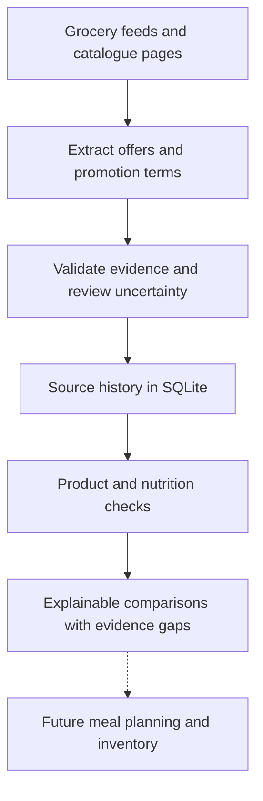
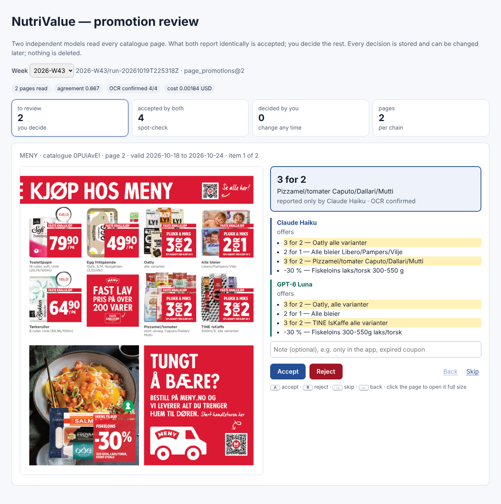

# NutriValue


[](LICENSE)


[](https://github.com/wintersyntax/nutrivalue-portfolio/actions/workflows/portfolio-ci.yml)

**Connecting grocery offers and nutrition evidence to more explainable shopping decisions.**

## The problem and idea

A catalogue price is not always the price a shopper can use: membership, multibuy terms, package sizes and previous prices change its meaning. Nutrition tables may describe a generic food rather than the product on sale. NutriValue brings those sources together while keeping identity, price conditions and evidence gaps visible.

The longer-term goal is practical shopping and meal preparation informed by budget, recipes and nutrition. The current implementation builds the data and review foundation for that goal.

## How it works

Python adapters collect source observations. Catalogue processing combines structured extraction, OCR checks and comparison between two models; an evidence-based review interface records human decisions. SQLite and SQL retain source-only offer history. Product and nutrition checks distinguish indicative estimates from comparisons supported by matching evidence.



The engine includes offer collection, conservative classification, promotion review, append-only decision logs, SQL analysis, a GET-only Mealie recipe reader and offline nutrition estimates. Package-content percentages are filtered out of discounts, and promotion pairing uses the best scope match across a page to avoid duplicate offers.

## See it in action



*Fictional products and prices illustrate the implemented review controls. The screenshot is not evidence of a current retailer price.*

Run the separate offline demo with Python 3.10+; no installation, API keys or network are needed:

```bash
python3 scripts/build_demo.py
python3 scripts/run_reports.py
python3 -m unittest discover -s tests -v
```

## Explore the implementation

[Implementation guide](docs/IMPLEMENTATION_GUIDE.md) · [Architecture and offer review](docs/ARCHITECTURE_AND_REVIEW.md) · [Engine source guide](engine/README.md) · [Development status](docs/DEVELOPMENT_SNAPSHOT.md) · [Roadmap](docs/PRODUCT_VISION.md)

## Current scope

This public edition contains real Python and SQL source alongside synthetic demonstrations. Source captures, private databases, original flyers, personal records, credentials and deployment configuration are excluded. OCR and exact product matching remain experimental; inventory integration, complete meal planning and write integrations remain future work. The strict real-price ranking has no qualifying real observations in the distributed demo.

MIT — see [LICENSE](LICENSE).
