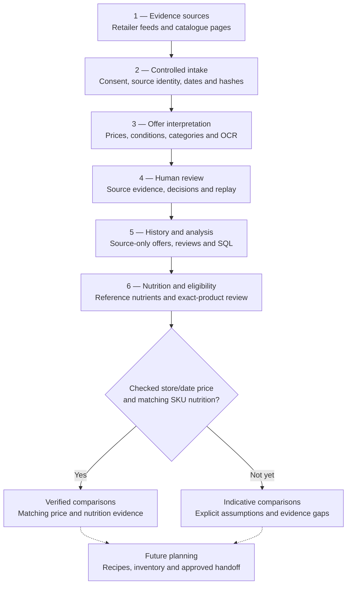
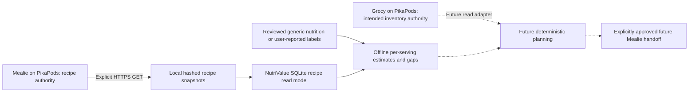
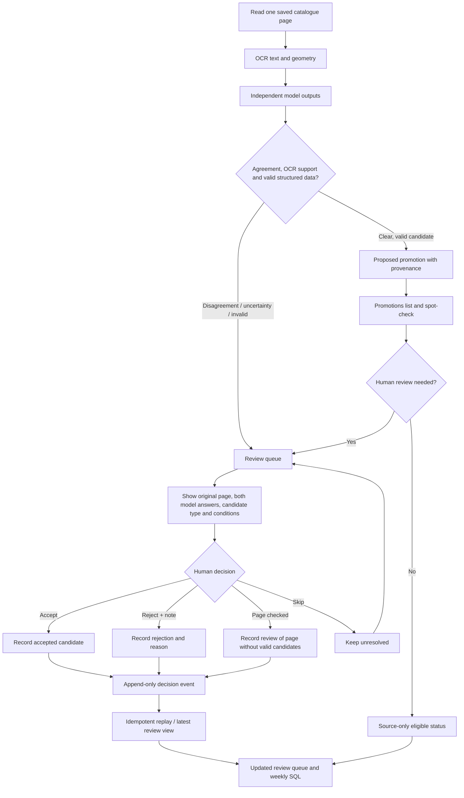

# Architecture & offer review

NutriValue is a nutrition-aware Norwegian grocery intelligence project. The flows below are grounded in the Python modules, SQL schemas, and test suites in the original source repository. **Do not confuse an imported advertisement with a verified price at checkout.**

## End-to-end architecture

**Status:** Source collection, classification, promotion extraction, SQL, local review UI and review-log algorithms exist in the original engineering code. The owner reports a deployed **private** weekly source-only collection job and an authenticated promotion-review service; this public source export includes neither deployment credentials nor provider datasets. NutriValue's general dashboard, recipe planner, Grocy adapter, Mealie write handoff and advanced optimization remain **future-only**. Use synthetic fixtures when demonstrating the UI.

**Future integration boundary (not deployed):** NutriValue is the **sole product**. An initial deterministic three-day-plus-four-day proposal uses reviewed/versioned recipes, ingredient basis, whole-package pricing and explicit uncertainty. Grocy/Pantry Raider is the intended future authoritative inventory snapshot and stock-movement record; NutriValue must not maintain a second mutable inventory. Mealie can later receive only approved managed recipe/meal/shopping data, while scheduled meals are never evidence of food consumption. An optional soft-preference optimizer waits for independently validated baseline plans and offline failure tests.

## Recipe read model and PikaPods

**Implemented code, public verification with synthetic inputs only (31 October
2026):** Mealie is a separate recipe application hosted on PikaPods. It owns
recipe content. NutriValue's explicit GET-only adapter reads recipe revisions,
hashes saved JSON and imports snapshots into a local SQLite calculation model;
it does not edit the Mealie library. PikaPods is the hosting layer, not an
additional nutrition authority or a replacement for NutriValue's offer pipeline.

Mass units can become grams; volume needs reviewed density, and pieces or
unparsed ingredients remain gaps. Generic references and user-reported package
labels retain their evidence classes. Partial totals cover mapped ingredients
only; missing values do not establish verified complete meal nutrition.

The recipe reader defaults to a no-network plan and has no instance URL.
A live read requires explicit local configuration and credentials. No live
account access was performed for this public sync. Grocy's hosting/setup does
not prove a working NutriValue inventory adapter. Mealie writes, inventory
transactions, the planner and task/consumption integration remain future work.
Instance names, personal recipes, pantry data, credentials and hosting
runbooks are excluded from the public release.

## Weekly coverage resilience

Each chain's latest usable run is selected separately. A later run that loses
a chain no longer hides that week's earlier offers or extracted promotions.
Health views expose missing data as red and fallback/partial data as amber.
Invalid offers are isolated, their rejection is counted, and page processing
skips chains whose source envelope remains quarantined. These are source-only
completeness signals, not price verification or a freshness guarantee.

## How an offer is reviewed

### Review interface

The local review tool is implemented in `src/nutrivalue/promotion_review_web.py` and launched by `scripts/review_promotions_web.py`. It binds only to the local loopback interface and uses the locally captured source images. It shows the selected week, catalogue chain/page, original image, each model's structured interpretation, detected promotion type, scope, member conditions, OCR support, status and notes. A reviewer can accept or reject a promotion, skip unresolved work, or mark a page checked when the source has no valid model response. The terminal alternative `scripts/review_promotions.py` provides the same decisions.

The hosted variant in `review_service.py` has an allowlisted Google account and signed session cookie. It writes a **new immutable decision object**, rather than directly editing the cloud database; a later replay validates the decision against its actual extraction/page/item and applies it once. **A review decision does not independently verify a current price at a specific store.**

### Synthetic review screenshot

The portfolio README includes a synthetic demonstration of the implemented reviewer controls. The illustrated products, prices and model interpretations are examples, not actual retailer observations or verified checkout prices. The image does not establish automatic verified SKU linking, extraction accuracy or production coverage.

## What makes the workflow conservative

- Provider/source observation, OCR text, model agreement, human review and independently confirmed shelf/checkout pricing are separate evidence states.
- Missing printed prices stay unresolved. Former prices, unit prices, member bonuses and bundles are not silently treated as simple current prices.
- Source hashes, catalogue/page identity, date windows and review events are preserved for replay and audit.
- Duplicate or malformed reviews do not create duplicate state changes, and review does not automatically enrich product identity or nutrition.
- The offer pipeline and generic nutrition store have no automatic name-based join to verified product prices.
