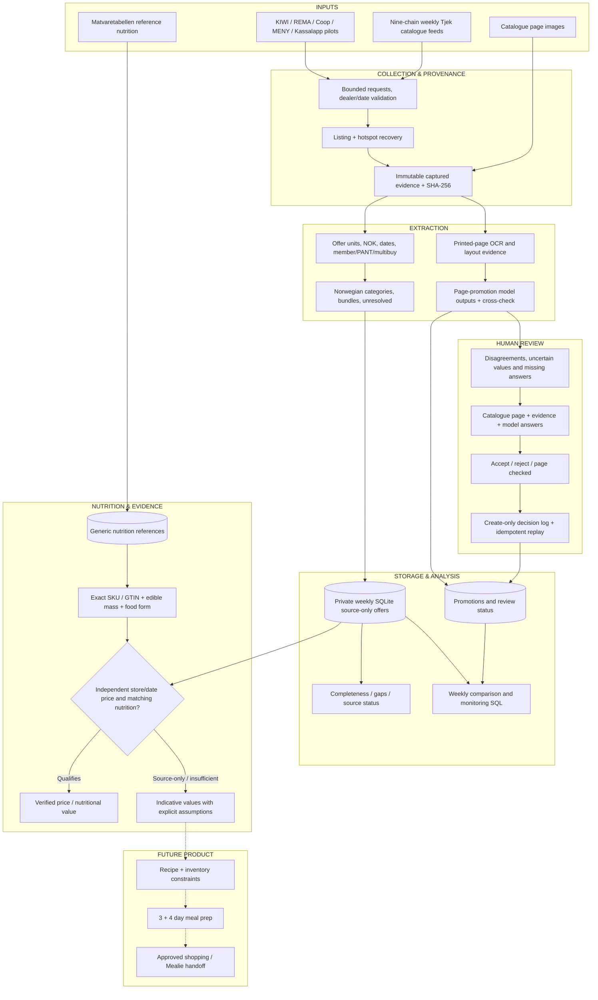
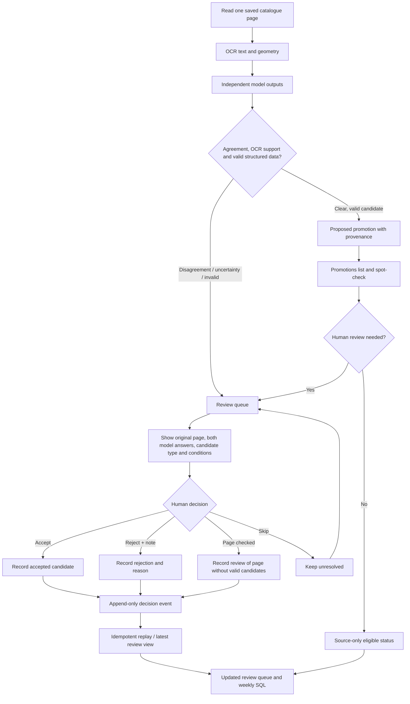

# Architecture & offer review

NutriValue is a nutrition-aware Norwegian grocery intelligence project. The flows below are grounded in the Python modules, SQL schemas, and test suites in the original source repository. **Do not confuse an imported advertisement with a verified price at checkout.**

## End-to-end architecture

**Status:** Source collection, classification, promotion extraction, SQL, local review UI and review-log algorithms exist in the original engineering code. The recipe optimizer and Mealie handoff are **planned**. Real provider captures and private storage are never bundled in the public portfolio. Use synthetic fixtures when demonstrating the UI.

## How an offer is reviewed

### Review interface

The local review tool is implemented in `src/nutrivalue/promotion_review_web.py` and launched by `scripts/review_promotions_web.py`. It binds only to the local loopback interface and uses the locally captured source images. It shows the selected week, catalogue chain/page, original image, each model's structured interpretation, detected promotion type, scope, member conditions, OCR support, status and notes. A reviewer can accept or reject a promotion, skip unresolved work, or mark a page checked when the source has no valid model response. The terminal alternative `scripts/review_promotions.py` provides the same decisions.

The hosted variant in `review_service.py` has an allowlisted Google account and signed session cookie. It writes a **new immutable decision object**, rather than directly editing the cloud database; a later replay validates the decision against its actual extraction/page/item and applies it once. **A review decision does not independently verify a current price at a specific store.**

### A synthetic screenshot

A screenshot for the portfolio should be visibly captioned **“Synthetic review demonstration — fictional page, prices and products”**. Suggested layout: source page image at left; extraction evidence and the two model answers in the middle; candidate status, source conditions and review buttons at right. Do not depict automatic verified SKU linking, final live price rankings, or production coverage that this review tool does not establish.

## What makes the workflow conservative

- Provider/source observation, OCR text, model agreement, human review and independently confirmed shelf/checkout pricing are separate evidence states.
- Missing printed prices stay unresolved. Former prices, unit prices, member bonuses and bundles are not silently treated as simple current prices.
- Source hashes, catalogue/page identity, date windows and review events are preserved for replay and audit.
- Duplicate or malformed reviews do not create duplicate state changes, and review does not automatically enrich product identity or nutrition.
- The offer pipeline and generic nutrition store have no automatic name-based join to verified product prices.
